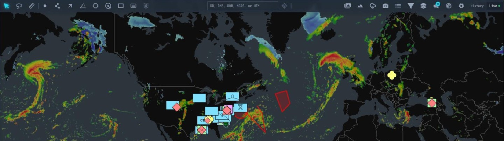

# OpenCOP

**Any data source. One shared picture.**

OpenCOP is an open-source, web-based common operating picture. Bring live data
from different systems into a shared operational map. Connect your sources,
map their fields visually, and explore how the picture changes over time.

Combine moving assets, incoming reports, weather overlays, and areas of
interest in one place. Organize information for different teams and give
each team access to the layers and data sources it needs.

[Try OpenCOP locally](#try-opencop) · [Bring your own data](#bring-your-own-data) ·
[Explore the source](#source-code)



*Example configured map with weather imagery, military point symbols, and drawn shapes.*

## What you can do

- **Connect your systems.** Connect to TCP feeds, receive UDP data, or publish data
  through Kafka using Bring Your Own Data (BYOD). Work with RTSP video and
  KLV telemetry alongside your map data.
- **Map your data visually.** Configure how fields in CSV, JSON, and XML
  become objects and events on the map.
- **Share the relevant picture.** Organize information into layers and data
  sources, with access controls for different users and teams.
- **Add geographic context.** Combine basemaps and 3D terrain with symbols,
  custom icons, and drawings such as points, lines, and polygons.
- **Follow change over time.** See live updates, inspect past events, and
  replay object movement.

## Try OpenCOP

This repository contains the OpenCOP application source and a Docker Compose
demo for local evaluation. Production infrastructure and deployment
automation are not included.

From the root of your cloned repository:

```bash
cd demo
docker compose up --build --wait --wait-timeout 900
```

Once startup completes, open <http://localhost> and sign in with username
`demo` and password `opencop-demo`.

You'll need Docker with Compose 2.36.2 or newer and Buildx, at least 12 GB of
memory available to Docker, and about 40 GB of free disk space. The first
source build can take 10–25 minutes.

A fresh demo opens on a basemap. Connect your own sources to populate the
operational picture; the data, weather imagery and scenario shown above are
not bundled demo content.

Try [your first moving object](demo/FIRST_DATA.md) with the included Kafka
producer after startup.

See the [demo guide](demo/README.md) for full prerequisites, stop and reset
commands, troubleshooting, and limitations.

## Bring your own data

Use a configured network connection or publish records through Kafka BYOD,
then choose a mapper to turn incoming fields into geographic features:

**Your system → connection or Kafka → field mapping → live map**

For example, a vehicle feed could map its fields like this:

| Incoming field | OpenCOP field |
| --- | --- |
| `vehicle_id` | Object ID |
| `vehicle_name` | Display Name |
| `lat` | Latitude |
| `lon` | Longitude |

Use a stable Object ID so later records from the same source update the same
vehicle. As new positions arrive, the vehicle's location updates on the map.

Field mapping is configured in the UI. Getting data from an external system
may involve configuring your system's export or connector, using a visual
integration tool, or writing a producer. Choose the approach that fits your
source and workflow.

## Source code

OpenCOP's source is available to inspect and adapt. The web application uses
a plugin architecture for tools and rendering; the backend provides
integration and mapping extension points.

- [`backend/`](backend/) — Java backend services.
- [`frontend/`](frontend/) — Web application.
- [`demo/`](demo/) — Docker Compose evaluation stack.

## Premium capabilities

For TAK integration and other premium capabilities, contact NTS at
[info@nextechsol.com](mailto:info@nextechsol.com).

## Reporting bugs

Reproducible bug reports, including documentation errors, are welcome in
[GitHub Issues](https://github.com/opencop-oss/opencop/issues).
We are not currently accepting feature requests or external pull requests.
See [CONTRIBUTING.md](CONTRIBUTING.md) for reporting guidance and the policy for
code and documentation changes.

Report suspected vulnerabilities privately as described in [SECURITY.md](SECURITY.md).

## License and notices

Licensed under the [Apache License 2.0](LICENSE). See [NOTICE](NOTICE) and the
[frontend third-party notices](frontend/THIRD_PARTY_NOTICES.md) for project and
third-party attribution.
